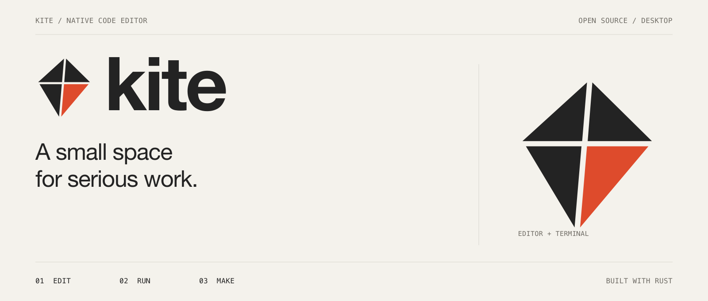
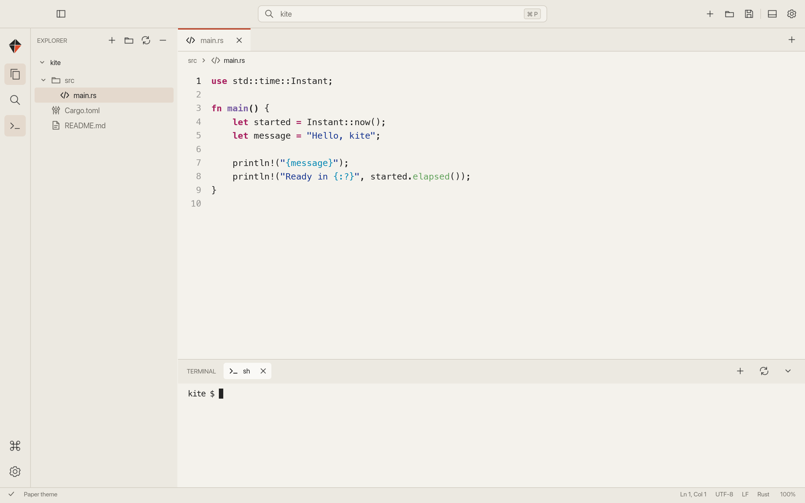

<p align="center">
  
</p>

<p align="center">
  A native editor. A real terminal. Room to think.
</p>

<p align="center">
  <a href="https://github.com/yesabhishek/kite/releases">Downloads</a> /
  <a href="#build-from-source">Build from source</a> /
  <a href="CONTRIBUTING.md">Contribute</a> /
  <a href="docs/design/application-identity.md">Design</a>
</p>

Kite is a small, open source desktop editor built in Rust. Open a folder, write code, and run it in an integrated terminal. A quiet workspace with careful typography, warm paper and graphite surfaces, and precise controls keeps the work in view.

Built with [Iced](https://iced.rs), Cosmic Text, Syntect, and Alacritty. No webview, account, marketplace, or telemetry.



## Install

Kite is in early development. Download installer packages from [GitHub Releases](https://github.com/yesabhishek/kite/releases), when available. Each release includes checksums and build information that identify its source and signing status. Preview builds may be unsigned; read the release notes before installing.

| Platform | Distribution | Install |
| --- | --- | --- |
| macOS, Apple Silicon | `kite-VERSION-macos-arm64.dmg` | Open the disk image and drag Kite to Applications. |
| macOS, Intel | `kite-VERSION-macos-x64.dmg` | Open the disk image and drag Kite to Applications. |
| Windows, x64 | `kite-VERSION-windows-x64-setup.exe` | Run the installer. It installs for the current user. |
| Linux | Source | Follow the build instructions below. |

macOS and Windows also have ZIP distributions. Installers live in GitHub Releases; GitHub Packages supports language and container registries and does not distribute these desktop installers.

## Make yourself at home

- **Edit with care.** Syntax highlighting, line numbers, tabs with cursor and undo history, find and replace, UTF-8/BOM support, LF/CRLF saving, atomic writes, and unsaved-change prompts.
- **Move by keyboard.** Quick open and the command palette stay close at hand. File indexing runs on demand, respects `.gitignore`, skips generated trees, and stops at 10,000 files.
- **Keep a shell nearby.** Independent terminal sessions use a real PTY with ANSI colors, selection, clipboard support, resizing, and bounded scrollback. Hidden sessions keep running.
- **Read what you write.** Native Code, Split, and Preview modes for Markdown and Mermaid. Mermaid rendering runs entirely in Rust, using `mermaid-rs-renderer` 0.3.1. Syntax and layout can differ from the JavaScript renderer.
- **Set your tone.** Dark, Paper, Graphite, Midnight, and Eucalyptus themes, independent editor font size, and app zoom from 75% to 150%. Panels resize and hide. Preferences return with your session.

Open Settings with `Cmd+,` on macOS or `Ctrl+,` on Windows and Linux. Existing preferences from the earlier development name are read automatically; future saves use Kite's configuration directory.

## Keyboard

| Action | macOS | Windows / Linux |
| --- | --- | --- |
| Quick open | Cmd+P | Ctrl+P |
| Command palette | Cmd+Shift+P / F1 | Ctrl+Shift+P / F1 |
| New / open / save | Cmd+N / O / S | Ctrl+N / O / S |
| Open folder / Save As | Cmd+Shift+O / S | Ctrl+Shift+O / S |
| Find and replace | Cmd+F | Ctrl+F |
| Undo / redo | Cmd+Z / Cmd+Shift+Z | Ctrl+Z / Ctrl+Shift+Z |
| Close tab | Cmd+W | Ctrl+W |
| Next / previous tab | Ctrl+Tab / Ctrl+Shift+Tab | Ctrl+Tab / Ctrl+Shift+Tab |
| Settings | Cmd+, | Ctrl+, |
| Toggle explorer / terminal | Cmd+B / J | Ctrl+B / J |
| New terminal | Cmd+Shift+N | Ctrl+Shift+N |
| Focus editor | F6 | F6 |
| App zoom / reset | Cmd+Plus / Minus / 0 | Ctrl+Plus / Minus / 0 |
| Editor font size | Option+Plus / Minus | Alt+Plus / Minus |
| Toggle preview | Cmd+Shift+V | Ctrl+Shift+V |
| Terminal copy / paste | Cmd+C / V | Ctrl+Shift+C / V |
| Interrupt process | Ctrl+C | Ctrl+C |

## Build from source

Use Rust 1.88 or newer. This is also the Linux installation path.

**macOS:** install Xcode Command Line Tools with `xcode-select --install`.

**Windows:** install the Rust MSVC toolchain and Visual Studio Build Tools with the Desktop development with C++ workload and Windows SDK.

**Linux, Debian or Ubuntu:** install the native libraries and a C compiler. Other distributions need equivalent packages. Run Kite inside a graphical desktop session.

```sh
sudo apt-get update
sudo apt-get install build-essential pkg-config libfontconfig1-dev libfreetype6-dev \
  libxkbcommon-dev libwayland-dev libx11-dev libxcursor-dev libxi-dev \
  libxrandr-dev libxcb-shape0-dev libxcb-xfixes0-dev
```

```sh
git clone https://github.com/yesabhishek/kite.git
cd kite
cargo build --release --locked
cargo run --release --locked -- . src/main.rs
```

On Linux, install the executable into your user path:

```sh
install -Dm755 target/release/kite "$HOME/.local/bin/kite"
kite .
```

Ensure `$HOME/.local/bin` is on your `PATH`. On Windows the built executable is `target/release/kite.exe`.

`kite [folder] [files...]` accepts one workspace folder and file paths. `--no-restore` skips the previous session. `--temporary-session` also leaves saved preferences untouched. Only saved paths and basic layout preferences persist. Unsaved text is protected by close prompts; crash recovery is not included.

## Develop in the open

`main` is the stable branch. `dev` is the integration branch. Open feature and fix pull requests against `dev`; release pull requests promote tested work from `dev` to `main`. CI checks formatting, Clippy, and native builds and tests across macOS, Windows, and Linux. Release workflows build macOS and Windows packages with checksums and create a draft for review.

```sh
cargo test --locked -p kite -p iced_term
cargo clippy --locked --all-targets -- -D warnings
cargo fmt --all -- --check
```

See [contributing](CONTRIBUTING.md), [release instructions](docs/RELEASING.md), [architecture](docs/ARCHITECTURE.md), [terminal behavior](docs/TERMINAL.md), and the [brand system](docs/design/application-identity.md).

Kite currently opens UTF-8 text files up to 10 MiB and supports one workspace folder. Language servers, debugging, Git UI, extension APIs, and crash recovery are outside the current scope. macOS is exercised locally. Windows and Linux require their native CI and desktop acceptance checks before a stable release.

## License

[MIT](LICENSE). Dependency licenses are preserved in [third-party notices](THIRD_PARTY_NOTICES.md). Please use a distinct name and identity for forks so users can tell projects apart. See the [brand guidelines](docs/design/application-identity.md).
