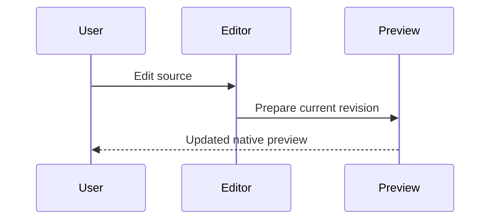

# Native document preview

Markdown stays in the editor while the preview updates beside it. **Bold**, *emphasis*, `inline code`, and [documentation links](https://www.rust-lang.org/learn) render as native widgets.

## Workspace flow


## Review checklist

- [x] Native Markdown rendering
- [x] Embedded Mermaid diagrams
- [x] Dark and light appearance
- [ ] Review the next change

| Capability | Rendering |
| --- | --- |
| Markdown | Native text and layout |
| Mermaid | Native SVG |
| Links | Explicit click action |

## Event sequence



## Example code

```rust
fn main() {
    println!("A native developer workspace");
}
```

> Previewing a file keeps the source available for editing.
